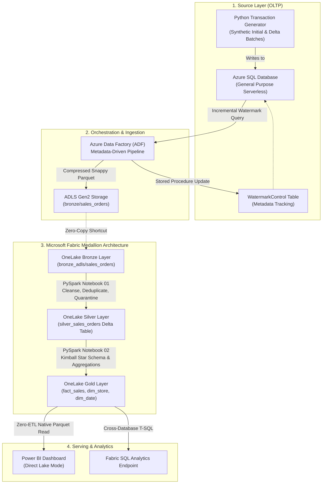

# Enterprise Hybrid Retail Lakehouse: Azure & Microsoft Fabric

[](https://azure.microsoft.com/)
[](https://fabric.microsoft.com/)
[](https://delta.io/)
[](https://spark.apache.org/)
[](https://powerbi.microsoft.com/)

A production-grade, end-to-end data platform demonstrating an enterprise **Medallion Architecture (Bronze $\to$ Silver $\to$ Gold)** that ingests transactional operational data from **Azure SQL Database**, processes incremental changes via **Azure Data Factory (ADF)**, virtualizes data using **Microsoft Fabric OneLake Shortcuts**, and serves analytics via **Power BI in Direct Lake Mode**.

---

## 1. Architecture Overview



---

## 2. Core Engineering Highlights

### A. Metadata-Driven Incremental Ingestion (Watermarking)
- Eliminates expensive full-table reloads by tracking high-watermark timestamps in `dbo.WatermarkControl`.
- ADF dynamically extracts only rows where `ModifiedDate > LastProcessedWatermark AND ModifiedDate <= MaxWatermark`.
- After successful copy to ADLS Gen2, an atomic stored procedure (`dbo.usp_UpdateWatermark`) advances the state.

### B. Zero-Copy Storage Virtualization (OneLake Shortcuts)
- Leverages **OneLake Shortcuts** to virtualize the ADLS Gen2 `bronze` container directly within the Fabric Lakehouse.
- **Zero data duplication** and **zero extra egress costs**: Spark notebooks query raw Parquet as if it were local to OneLake.

### C. Silver Layer Quality Gating & ACID Upsert
- **Circuit-Breaker Data Quality:** Automatically identifies invalid primary keys or negative balances, diverting anomalous records to `silver_quarantined_orders` for auditing.
- **Windowed Deduplication:** Resolves multiple in-batch status updates using `row_number() over (partition by OrderID order by ModifiedDate desc)`.
- **Delta Lake MERGE:** Implements idempotent upserts into `silver_sales_orders`, updating existing records if incoming timestamps are newer, otherwise appending new orders.
- **Compaction & FinOps:** Applies `OPTIMIZE silver_sales_orders ZORDER BY (OrderDateOnly, CustomerID)` to co-locate Parquet files and mitigate small-file syndrome.

### D. Kimball Star Schema Gold Layer
- **Conformed Dimensions:** Generates `dim_date` (temporal hierarchies) and `dim_store` (surrogate keys, channels, regional groupings).
- **Transactional Fact:** `fact_sales` links dimensions with metrics (`GrossSalesAmount`, `NetSalesAmount`, `TaxAmount`, `ShippingCost`).
- **Pre-Aggregated Table:** `gold_daily_store_sales` computes daily revenue rollups for C-suite reporting.

### E. Power BI Direct Lake Mode
- Connects directly to OneLake Gold Delta tables without importing data or converting DAX into slow DirectQuery SQL.
- Leverages the **VertiPaq** engine directly over OneLake Parquet files for sub-second query performance on fresh data.

---

## 3. FinOps & Cloud Cost Governance

Engineered to operate within strict cloud budget parameters (< \$15 total cost):
- **Serverless Azure SQL Database:** Configured with minimum 0.5 vCore compute and **60-minute auto-pause**, eliminating idle costs.
- **Ephemeral Spark Compute:** Fabric Serverless Spark operates entirely within the 60-day trial capacity (F64 equivalent at \$0).
- **Storage Lifecycle:** Compressed Snappy Parquet and Delta V-Order optimization reduce storage footprint by > 60%.

---

## 4. Repository Structure

```text
├── .env.example                               # Database configuration template
├── README.md                                  # Architectural documentation & project overview
├── requirements.txt                           # Python dependencies
├── notebooks/
│   ├── 01_bronze_to_silver_sales_orders.py    # Fabric PySpark: Deduplication, quality gate, Delta merge
│   └── 02_silver_to_gold_star_schema.py      # Fabric PySpark: Kimball Star Schema generation & Z-Order
├── sql/
│   └── 01_init_transactional_db.sql           # DDL, indexes, and watermarking stored procedures
└── src/
    ├── check_status.py                        # Database & watermark health check script
    └── generate_transactions.py               # Synthetic retail transaction generator (Initial & Incremental)
```

---

## 5. How to Replicate

### 1. Database Initialization
1. Deploy an **Azure SQL Database (Serverless, Auto-Pause enabled)**.
2. Execute [sql/01_init_transactional_db.sql](sql/01_init_transactional_db.sql) via Azure Query Editor.

### 2. Seed Baseline Data
```bash
python3 -m venv .venv
source .venv/bin/activate
pip install -r requirements.txt
cp .env.example .env # Fill in your DB server credentials
python src/generate_transactions.py --mode initial --orders 2000
```

### 3. Deploy Cloud Infrastructure
1. Provision **ADLS Gen2** (`bronze` container) and **Azure Data Factory**.
2. Configure ADF linked services and pipeline `pl_ingest_sales_orders_incremental`.
3. In Microsoft Fabric, create Lakehouse `lh_retail_lakehouse` and create a OneLake shortcut to the ADLS Gen2 `bronze` container.

### 4. Execute Medallion Transformations
1. Run [notebooks/01_bronze_to_silver_sales_orders.py](notebooks/01_bronze_to_silver_sales_orders.py).
2. Run [notebooks/02_silver_to_gold_star_schema.py](notebooks/02_silver_to_gold_star_schema.py).
3. Connect a semantic model in **Direct Lake Mode** to build Power BI reports.

### 5. Test Incremental Updates
```bash
python src/generate_transactions.py --mode incremental --orders 150
```
Trigger the ADF pipeline and re-run notebooks to observe the automated delta ingestion and report refresh.
